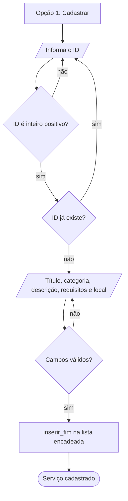

<p align="center">
  
</p>

<p align="center">
  
  
  
  
  
  
</p>

# Citizen Assist AI

Protótipo em **Python** que organiza e consulta **serviços e orientações ao cidadão** (saúde, assistência social, documentação, educação e serviços urbanos), desenvolvido para a **Global Solution 2026.2 — Citizen Tech**, disciplina de *Data Structures and Algorithms*.

Todas as estruturas e algoritmos foram **implementados pela equipe**: lista encadeada, busca linear e Merge Sort. O projeto não usa `sorted`, `list.sort` nem `list` para guardar os registros.

## Sumário

- [Funcionalidades](#funcionalidades)
- [Demonstração](#demonstração)
- [Como executar](#como-executar)
- [Arquitetura](#arquitetura)
- [Modelo de dados](#modelo-de-dados)
- [Lista encadeada](#lista-encadeada)
- [Algoritmos](#algoritmos)
- [Complexidade (Big-O)](#complexidade-big-o)
- [Validação de entradas](#validação-de-entradas)
- [Testes](#testes)
- [Estrutura do repositório](#estrutura-do-repositório)
- [Requisitos da Global Solution](#requisitos-da-global-solution)
- [Integrantes](#integrantes)

---

## Funcionalidades

| | Funcionalidade | Descrição |
|---|---|---|
| ➕ | **Cadastrar** | Registro com ID único, título, categoria, descrição, requisitos e local |
| 🔎 | **Consultar por ID** | Ficha completa do serviço |
| ✏️ | **Atualizar** | Mostra os valores atuais; Enter mantém o valor; o ID não muda |
| 🗑️ | **Excluir** | Mostra o registro e pede confirmação antes de remover |
| 🧭 | **Pesquisar** | Por título ou categoria, ignorando acentos e maiúsculas |
| 🔢 | **Ordenar** | Merge Sort por ID, título ou categoria |
| 📊 | **Análise** | Total de registros, quantidade e percentual por categoria |
| 💾 | **Persistência** | Salva e carrega em JSON (opcional) |

---

## Demonstração

As capturas abaixo vêm da execução **real** do programa. O texto digitado aparece em amarelo.

### Menu principal


### Listagem e pesquisa

| Listagem (após carregar os exemplos) | Pesquisa com e sem resultado |
|---|---|
|  |  |

### Ordenação com Merge Sort


### Validação de entradas no cadastro

ID duplicado, ID não numérico, ID negativo, título vazio e categoria fora das opções são rejeitados, com nova tentativa.


### Exclusão com confirmação


### Análise por categoria


### Operações com a lista vazia


---

## Como executar

**Requisito:** Python 3.9 ou superior. Não há dependências externas.

```bash
# 1. entre na pasta do projeto
cd citizen_assist_ai

# 2. execute o programa
python citizen_assist.py                    # usa dados_cidadao.json (criado ao encerrar)
python citizen_assist.py meu_arquivo.json   # ou outro arquivo de dados

# 3. execute os testes
python -m unittest -v test_citizen_assist
```

> 💡 Na primeira execução, use a opção **10** do menu para carregar 8 serviços de exemplo (fictícios).

Ao encerrar (opção `0`, Ctrl+C ou Ctrl+D), os dados são salvos automaticamente no arquivo JSON.

### Fluxo de cadastro



---

## Arquitetura

O código está dividido em camadas, cada uma com uma responsabilidade.


| Camada | Arquivo | Responsabilidade |
|---|---|---|
| Menu | `citizen_assist.py` | Entrada e saída, leitura validada e exibição das telas |
| Regras de negócio | `citizen_assist.py` (`SistemaCidadao`) | CRUD, validação, análise e persistência, sem `print` ou `input` |
| Algoritmos | `algoritmos.py` | Busca linear, pesquisa por atributo, Merge Sort e contagem |
| Estruturas | `estruturas.py` | `Servico`, `No` e `ListaEncadeada` |

Como o núcleo (`SistemaCidadao`) não faz entrada e saída, ele é testado diretamente, sem o menu.

---

## Modelo de dados

**Recorte escolhido:** guia de serviços públicos ao cidadão, com cinco categorias fixas: *Saúde*, *Assistência Social*, *Documentação e Cidadania*, *Educação e Qualificação* e *Serviços Urbanos*.

| Campo | Tipo | Regra |
|---|---|---|
| `id` | `int` | Inteiro positivo, até 999.999, **único** |
| `titulo` | `str` | Obrigatório, até 120 caracteres |
| `categoria` | `str` | Uma das 5 categorias oficiais |
| `descricao` | `str` | Obrigatório, até 500 caracteres |
| `requisitos` | `str` | Obrigatório, até 300 caracteres |
| `local` | `str` | Obrigatório, até 150 caracteres |

> Os serviços de exemplo são **fictícios** e servem só para demonstração.

---

## Lista encadeada

Lista **simples** com referências para a cabeça e a cauda, implementada com classes, objetos e referências entre nós.


```python
class No:
    __slots__ = ("servico", "proximo")

    def __init__(self, servico, proximo=None):
        self.servico = servico      # o registro guardado neste nó
        self.proximo = proximo      # referência ao próximo nó (ou None)
```

**Operações:** `inserir_inicio`, `inserir_fim`, `remover_por_id`, percurso (`__iter__`), `esta_vazia`, `limpar` e `substituir_cabeca` (usada pela ordenação).

### Remoção preservando a integridade

`remover_por_id` trata os três casos (cabeça, meio e cauda), atualiza `cauda` e o tamanho da lista e desconecta o nó removido.


```python
def remover_por_id(self, id_servico):
    anterior, atual = None, self.cabeca
    while atual is not None:
        if atual.servico.id == id_servico:
            if anterior is None:          # remoção da cabeça
                self.cabeca = atual.proximo
            else:                         # meio ou fim
                anterior.proximo = atual.proximo
            if atual is self.cauda:       # removeu a cauda
                self.cauda = anterior
            atual.proximo = None
            self._tamanho -= 1
            return atual.servico
        anterior, atual = atual, atual.proximo
    return None
```

Em Python não há gerenciamento manual de memória: os nós sem referência são liberados pelo coletor de lixo.

---

## Algoritmos

### Busca por ID: busca linear

Percorre os nós a partir da cabeça e para no primeiro `id` igual. Se chegar ao fim (ou a lista estiver vazia), devolve `None` e o menu informa que nada foi encontrado.

Não se usa busca binária porque a lista encadeada não permite acesso direto ao elemento do meio.

### Pesquisa por título ou categoria

Busca linear por **substring**, ignorando maiúsculas e acentos (`"saude"` encontra `"Saúde"`). Devolve todas as ocorrências.

### Ordenação: Merge Sort sobre lista encadeada

1. **Dividir:** ponteiros lento/rápido encontram o meio e cortam a cadeia em duas.
2. **Ordenar** recursivamente cada metade.
3. **Mesclar:** intercala as duas cadeias **religando os nós**, sem copiar a lista.


```python
def merge_sort_nos(cabeca, chave):
    if cabeca is None or cabeca.proximo is None:
        return cabeca
    segunda = _dividir(cabeca)
    esquerda = merge_sort_nos(cabeca, chave)
    direita = merge_sort_nos(segunda, chave)
    return _mesclar(esquerda, direita, chave)
```

O Merge Sort foi escolhido porque se adapta bem a listas encadeadas: não precisa de acesso por índice e garante O(n log n) em qualquer caso. Ele é estável.

Critérios disponíveis: `id`, `titulo` (sem acento/caixa, desempate por id) e `categoria` (desempate por título e id).

---

## Complexidade (Big-O)

*n* = número de registros; *m* = tamanho do texto comparado.

| Operação | Melhor caso | Pior caso | Justificativa |
|---|---|---|---|
| Inserção no início/fim | O(1) | O(1) | Referências para cabeça e cauda; só ajusta ponteiros |
| **Cadastro completo** | O(1) | O(n) | Antes de inserir, verifica a unicidade do ID com busca linear |
| Busca por ID | O(1) | O(n) | Linear; melhor caso é o registro na cabeça |
| Pesquisa por título/categoria | O(n·m) | O(n·m) | Percorre toda a lista para devolver todas as ocorrências |
| Remoção por ID | O(1) | O(n) | Localizar é O(n); religar ponteiros é O(1) |
| Atualização | O(1) | O(n) | Dominada pela busca do registro |
| Percurso / listagem | O(n) | O(n) | Visita cada nó uma vez |
| **Ordenação (Merge Sort)** | O(n log n) | O(n log n) | log n níveis de divisão, com O(n) de trabalho por nível |
| Análise por categoria | O(n) | O(n) | Uma passada, com contagem em dicionário |
| Salvar em arquivo | O(n) | O(n) | Percorre a lista uma vez |
| Carregar de arquivo | O(n²) | O(n²) | Cada registro passa pelo cadastro, que verifica duplicidade em O(n) |

**Espaço do Merge Sort:** O(log n) de pilha de recursão, sem cópia da lista.

### Conferindo na prática

O script `docs/gerar_imagens.py` mede o tempo de ordenação e de busca (pior caso) para listas de 1.000 a 32.000 registros. A linha tracejada é a curva teórica ajustada ao último ponto.


> Os tempos absolutos variam de máquina para máquina. A busca fica um pouco abaixo da reta nos tamanhos pequenos porque listas menores cabem melhor no cache do processador. O importante é a **forma** da curva: linear para a busca e O(n log n) para a ordenação.

---

## Validação de entradas

| Situação | Comportamento |
|---|---|
| Opção inexistente ou vazia no menu | Mensagem e retorno ao menu |
| ID não numérico, zero, negativo, decimal ou muito grande | Rejeitado, com nova tentativa |
| ID duplicado | Rejeitado, nada é inserido |
| Campo vazio, só espaços ou acima do limite | Rejeitado, com nova tentativa |
| Categoria fora de 1 a 5 | Nova tentativa |
| Atualização inválida | O registro permanece **intacto** (valida tudo antes de alterar) |
| ID inexistente (consultar, atualizar, excluir) | Mensagem clara |
| Lista vazia | Mensagem apropriada, sem erro |
| Ctrl+C / Ctrl+D | Encerra com segurança, salvando os dados |
| Arquivo JSON corrompido | Aviso e início com lista vazia |
| Registros inválidos ou duplicados no JSON | Ignorados e contados |

---

## Testes

São **47 testes automatizados** (`unittest`, sem dependências), todos passando.


| Grupo | O que verifica |
|---|---|
| Lista encadeada | Lista vazia, inserção, remoção de cabeça/meio/cauda/único, ID inexistente, `cauda` válida após remover |
| Busca | ID existente e inexistente, lista vazia, acentos e maiúsculas, categoria, sem resultado |
| Ordenação | Por id/título/categoria, desempate, lista vazia, 1 elemento, já ordenada e inversa, critério inválido |
| CRUD e validação | Cadastro, **ID duplicado**, 10 tipos de ID inválido, campos vazios/longos, categoria inválida, atualização sem alterar o registro em caso de erro |
| Análise | Lista vazia e com dados (a soma das categorias é igual ao total) |
| Persistência | Salvar e recarregar, arquivo inexistente, corrompido, registros inválidos |
| Menu (entrada simulada) | Opções inválidas, lista vazia, cadastro com entradas ruins, pesquisa sem resultado, exclusão com confirmação |

A saída completa está em [`evidencias_testes.txt`](evidencias_testes.txt) e uma sessão completa do menu em [`evidencias_demonstracao.txt`](evidencias_demonstracao.txt).

---

## Estrutura do repositório

```
citizen_assist_ai/
├── README.md
├── DOCUMENTACAO.md              # documentação técnica detalhada
├── citizen_assist.py            # menu + SistemaCidadao (regras, validação, persistência)
├── estruturas.py                # Servico, No, ListaEncadeada
├── algoritmos.py                # busca linear, pesquisa, Merge Sort, contagem
├── test_citizen_assist.py       # 47 testes automatizados
├── evidencias_testes.txt
├── evidencias_demonstracao.txt
└── docs/
    ├── gerar_imagens.py         # gera as imagens deste README
    └── img/                     # capturas do terminal e diagramas
```

Para regenerar as imagens: `pip install pillow matplotlib` e `python docs/gerar_imagens.py`.

---

## Requisitos da Global Solution

- [x] Linguagem Python, com classes para registros e nós e lista encadeada explícita
- [x] Cadastro de múltiplos registros com identificador único, mantidos na lista encadeada
- [x] Consulta por ID e pesquisa por título e por categoria, com tratamento de "nada encontrado"
- [x] Ordenação com algoritmo implementado pela equipe (Merge Sort), sem funções prontas
- [x] Lista encadeada com inserção, percurso e remoção
- [x] Atualização e exclusão preservando a integridade da lista
- [x] Processamento útil: análise de serviços por categoria
- [x] Menu interativo com todas as operações e validação de entradas
- [x] Análise Big-O de inserção, busca, remoção e ordenação
- [x] Testes: casos normais, inexistentes, inválidos e lista vazia
- [x] Opcionais: persistência em JSON e relatório com percentuais

---

## Integrantes

| Nome | RM |
|---|---|
| _Rafael Sá_ | _569223_ |
| _João Melo_ | _571116_ |
| _Gabriel Souza_ | _571583_ |

---

<p align="center">Projeto acadêmico · Global Solution 2026.2 · Citizen Tech</p>
